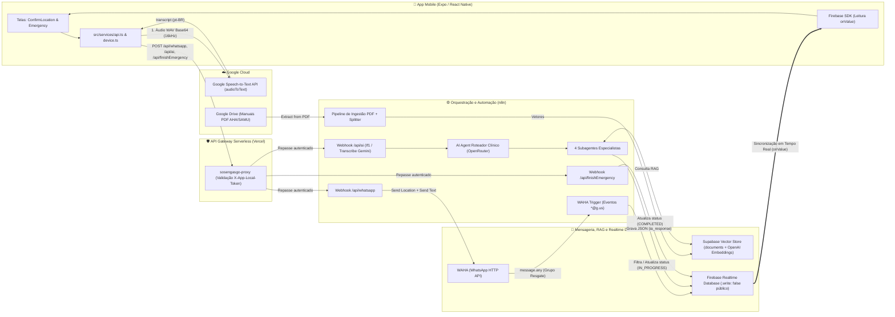

# 🚨 SOS Engasgo - React Native

<div align="center">

[](https://reactnative.dev/)
[](https://www.typescriptlang.org/)
[](https://docs.expo.dev/versions/v58.0.0/)
[](https://firebase.google.com/)
[](https://github.com/thibastos0/SOSEngasgo_ReactNative)

*Aplicativo mobile de apoio em situações de engasgo, desenvolvido como Projeto Integrador na **Fatec Indaiatuba** (Curso Superior de Tecnologia em Desenvolvimento de Software Multiplataforma - DSM).*

</div>

---

## 💡 Sobre o projeto

O **SOS Engasgo** é um aplicativo de suporte rápido desenvolvido para orientar o usuário e agilizar o pedido de ajuda durante uma emergência de engasgo. A aplicação prioriza acesso imediato sem obrigatoriedade de login, botões de ação destacados, instruções visuais animadas e triagem clínica por voz assistida por inteligência artificial multiagente (RAG) para reduzir o tempo de resposta em situações críticas.

O fluxo principal atualmente implementado é:

1. **Acesso direto à tela inicial (`Home`):** ao abrir o aplicativo, o usuário já visualiza o botão central de emergência, sem barreira de login obrigatório, além do menu lateral (`Drawer`) e atalho opcional para autenticação no cabeçalho.
2. **Confirmação de localização (`ConfirmLocation`):** solicita permissão de GPS em primeiro plano, centraliza o mapa na posição atual e permite ajustar o marcador manualmente (com fallback informativo na Web).
3. **Identificação anônima e disparo do socorro (`/api/whatsapp`):** gera/recupera um `deviceId` seguro no dispositivo, cria um protocolo único (`SOC-YYYYMMDD-HHMMSS`) e envia o chamado com coordenadas geográficas ao **Proxy Serverless na Vercel**, que aciona o **n8n** e o **WAHA (WhatsApp HTTP API)** para notificar o grupo da equipe de resgate.
4. **Socorro em andamento (`Emergency`):** acompanha em tempo real o status do atendimento via listener `onValue` no **Firebase Realtime Database** (`SENT`, `IN_PROGRESS`, `COMPLETED`) — atualizado automaticamente quando a equipe de resgate interage no WhatsApp — e exibe instruções de primeiros socorros com ilustrações animadas (GIFs).
5. **Assistente de voz com IA Multiagente e RAG (*Hold to talk*):** grava áudio em formato WAV (`LINEAR16`, `16 kHz`), realiza transcrição rápida via **Google Cloud Speech-to-Text** (`audioToText`) e envia ao endpoint `/api/ai`. No backend (**n8n + OpenRouter + Supabase Vector Store**), um agente roteador aciona subagentes clínicos especializados (AHA/SAMU) e grava a orientação estruturada no Firebase para renderização imediata no app.
6. **Encerramento seguro (`/api/finishEmergency`):** solicita confirmação ao usuário e aciona o proxy na Vercel para que o **n8n** realize a atualização administrativa do status para `COMPLETED` no Firebase (preservando `.write: false` para clientes públicos).
7. **Fluxo secundário de conta (demonstrativo):** telas de Login e Cadastro com validação local de campos obrigatórios e confirmação de senha.

> **Nota sobre o estado das funcionalidades:** todo o fluxo de emergência já opera integrado à arquitetura real de backend (Proxy Serverless na Vercel, orquestração no n8n, mensageria via WAHA, Speech-to-Text, IA multiagente com RAG no Supabase e sincronização em tempo real no Firebase Realtime Database). Já os módulos de **Login**, **Cadastro** (incluindo login com Google), **Treinamentos** e **Orientações** permanecem demonstrativos ou em desenvolvimento, sem persistência de contas de usuário.

---

## 🏗️ Arquitetura de Backend, Automação e IA

Por segurança, o aplicativo React Native (Expo / TypeScript) **não se comunica diretamente com o n8n** nem possui permissão de escrita aberta no **Firebase Realtime Database** (`.write: false` para clientes públicos).

Toda comunicação externa de comando passa por um **API Gateway / Proxy Serverless hospedado na Vercel** ([`thibastos0/sosengasgo-proxy`](https://github.com/thibastos0/sosengasgo-proxy)), autenticado via cabeçalho HTTP `X-App-Local-Token`, que valida a origem e repassa as requisições de forma segura aos webhooks do **n8n**.

### Diagrama de Arquitetura



### Fluxos Operacionais Detalhados (n8n)

#### 1. Acionamento de Socorro via WhatsApp (`/api/whatsapp` → n8n Webhook → WAHA)
- O aplicativo coleta `protocol_id`, `device_id`, `latitude` e `longitude` na tela `ConfirmLocationScreen` e envia via `sendEmergencyWhatsApp()` ao Proxy Vercel (`/api/whatsapp`).
- O **n8n** recebe o payload pelo webhook, processa os campos e aciona o **WAHA (WhatsApp HTTP API)** em duas etapas consecutivas no grupo da equipe de resgate:
  1. Disparo das coordenadas geográficas exatas (`Send Location`);
  2. Disparo da mensagem textual de alerta contendo os dados da ocorrência (`Send a text message`).

#### 2. Monitoramento e Atualização de Status via WhatsApp (`WAHA Trigger` → n8n → Firebase)
- Um workflow dedicado no **n8n** escuta eventos `message.any` provenientes de grupos do WhatsApp (`*@g.us`) por meio do nó `WAHA Trigger`.
- As mensagens recebidas passam por nós de filtragem, validação e transformação (`If`, `Edit Fields`, `Code in JavaScript`) para identificar respostas da equipe de socorro vinculadas ao protocolo.
- O **n8n** atualiza automaticamente o nó da ocorrência (`emergencies/{device_id}/{protocol_id}`) no **Firebase Realtime Database** (ex.: alterando `status` para `IN_PROGRESS`), refletindo instantaneamente na tela do usuário via listener `onValue`.

#### 3. Triagem Clínica Multiagente e RAG (`/api/ai` → n8n AI Agent → Supabase + Firebase)
- **Entrada Híbrida (Áudio ou Texto):** Ao soltar o botão *Hold to talk*, o aplicativo lê o áudio `.wav` (`LINEAR16`, `16 kHz` mono) em Base64 e realiza a transcrição rápida no cliente via **Google Cloud Speech-to-Text** (`audioToText`), enviando o `transcript` para `/api/ai` (com suporte também ao envio direto de `audio_base64`). No **n8n**, o nó condicional (`If1`) verifica se o texto transcrito já está presente na requisição ou se deve acionar o nó nativo de transcrição (`Transcribe a recording` via Google Gemini).
- **Roteamento Clínico (`AI Agent` + OpenRouter):** Um agente roteador principal analisa o relato da emergência, classifica o perfil e o estado da vítima e invoca exclusivamente uma das **4 ferramentas especialistas**, seguindo protocolos oficiais da **AHA / SAMU**:
  - `SubagenteLactente`: engasgo em bebês menores de 1 ano (golpes dorsais e compressões torácicas);
  - `SubagenteAdultoCrianca`: engasgo em crianças (> 1 ano) e adultos conscientes (Manobra de Heimlich / compressões abdominais);
  - `SubagenteGestanteObeso`: adaptação para gestantes e pessoas obesas (compressões torácicas no esterno);
  - `SubagenteInconsciente`: vítima irresponsiva / evolução para parada cardiorrespiratória (protocolo de RCP e desobstrução de vias aéreas).
- **Base de Conhecimento Vetorial (RAG):** Cada subagente consulta a tabela `documents` no **Supabase Vector Store**, abastecida por um pipeline de ingestão dedicado no n8n que busca manuais clínicos oficiais em PDF no **Google Drive** (`Extract from PDF`), segmenta o conteúdo (`Recursive Character Text Splitter`) e gera vetores semânticos com `Embeddings OpenAI`.
- **Saída Estruturada e Persistência:** A resposta final é estruturada em JSON (`ia_status`, `response_text`, `img`, `maneuver: { title, steps }`), validada, sanitizada e gravada pelo n8n diretamente em `emergencies/{device_id}/{protocol_id}/ia_response` no **Firebase Realtime Database**. O aplicativo consome essa atualização em tempo real e renderiza o passo a passo junto à animação correspondente em `assets/images/*.gif`.

#### 4. Encerramento Seguro da Ocorrência (`/api/finishEmergency` → n8n → Firebase)
- Ao tocar em **"Socorro Chegou / Encerrar"** e confirmar o diálogo na `EmergencyScreen`, o aplicativo chama `finishEmergencyAPI()` enviando `{ action: 'COMPLETED', protocol_id, device_id }` para `/api/finishEmergency` no Proxy Vercel.
- O proxy encaminha a requisição ao **n8n**, que executa a escrita administrativa no **Firebase Realtime Database** alterando o status da ocorrência para `COMPLETED`, mantendo o banco protegido contra escritas diretas de clientes públicos (`.write: false`).

---

## ✨ Funcionalidades implementadas

- **Acionamento rápido sem login:** abertura direta na tela inicial com cartão de emergência em destaque.
- **Identificação anônima persistente:** geração de UUID v4 (`expo-crypto`) armazenado com segurança no `expo-secure-store` e criação de protocolo `SOC-YYYYMMDD-HHMMSS`.
- **Geolocalização e mapa interativo:** captura da posição atual (`expo-location`) com pino arrastável em Android/iOS (`react-native-maps`) e componente de fallback dedicado para Web (`CustomMap.web.tsx`).
- **Disparo real de emergência via Proxy Vercel (`/api/whatsapp`):** envio autenticado (`X-App-Local-Token`) de protocolo, `deviceId` e coordenadas para acionamento automatizado da equipe de resgate via n8n + WAHA.
- **Monitoramento reativo em tempo real:** assinatura (`onValue`) no Firebase Realtime Database (`emergencies/{deviceId}/{protocolId}`) para refletir mudanças de status (`SENT`, `IN_PROGRESS`, `COMPLETED`) e orientações da IA sem necessidade de *polling*.
- **Triagem por voz com IA Multiagente e RAG (*Hold to talk*):** captura de áudio otimizada (`16 kHz`, `.wav`), transcrição rápida via Google Speech-to-Text (`audioToText`) e envio para `/api/ai` (`sendAudioToAI`).
- **Ilustrações animadas de manobras:** exibição de 12 GIFs locais com `expo-image` contemplando Manobra de Heimlich, desobstrução de vias aéreas e RCP para adultos, gestantes, crianças e lactentes (`maneuverAssets.ts`).
- **Cancelamento e encerramento seguros (`/api/finishEmergency`):** diálogos de confirmação nativos (Android/iOS) e Web (`window.confirm`) com finalização administrativa da ocorrência no Firebase via n8n.
- **Navegação híbrida (`Stack` + `Drawer`):** pilha principal combinada com menu lateral para acesso às seções **Início**, **Treinamentos** e **Orientações**.
- **Telas demonstrativas de autenticação:** interface de Login e formulário de Cadastro com validação de preenchimento e igualdade de senhas.
- **Interface padronizada e reutilizável:** cabeçalho adaptativo, rodapé com link para o GitHub, cartões, inputs e botões com suporte a `ActivityIndicator`.

---

## 🛠️ Tecnologias utilizadas

### Front-end Mobile & Web (Este Repositório)
- **[Expo SDK 58](https://docs.expo.dev/versions/v58.0.0/)** — Plataforma e ferramentas para desenvolvimento React Native multiplataforma.
- **[React Native 0.88](https://reactnative.dev/)** — Framework para construção de interfaces nativas Android e iOS.
- **[React 19.3](https://react.dev/)** — Biblioteca base para construção de componentes e gerenciamento de estado.
- **[TypeScript 6.0](https://www.typescriptlang.org/)** — Tipagem estática com `strict: true` e alias de caminho `@/*`.
- **[React Navigation 7](https://reactnavigation.org/)** — Roteamento com `Native Stack` e `Drawer Navigator`.
- **[Firebase Web SDK 13.1](https://firebase.google.com/docs/database)** — Consumo em tempo real (somente leitura pelo cliente) do Realtime Database.
- **[react-native-maps 1.29](https://github.com/react-native-maps/react-native-maps)** — Renderização de mapa nativo e marcador ajustável.
- **[expo-location](https://docs.expo.dev/versions/v58.0.0/sdk/location/)** — Solicitação de permissão e leitura de coordenadas GPS.
- **[expo-audio](https://docs.expo.dev/versions/v58.0.0/sdk/audio/)** & **[expo-file-system](https://docs.expo.dev/versions/v58.0.0/sdk/filesystem/)** — Gravação de voz (`16 kHz` WAV/LPCM) e codificação do arquivo de áudio em Base64.
- **[expo-image](https://docs.expo.dev/versions/v58.0.0/sdk/image/)** — Renderização performática de imagens e GIFs animados das manobras.
- **[expo-secure-store](https://docs.expo.dev/versions/v58.0.0/sdk/securestore/)** & **[expo-crypto](https://docs.expo.dev/versions/v58.0.0/sdk/crypto/)** — Geração e armazenamento seguro do identificador anônimo da instalação.
- **[@expo/vector-icons](https://docs.expo.dev/guides/icons/)** — Ícones (`MaterialCommunityIcons` e `MaterialIcons`).
- **[react-native-reanimated 4.7](https://docs.swmansion.com/react-native-reanimated/)** & **[react-native-gesture-handler 3.3](https://docs.swmansion.com/react-native-gesture-handler/)** — Gestos e animações da navegação.

### Ecossistema de Backend, Mensageria e IA Integrado
- **[SOS Engasgo Proxy (Vercel Serverless)](https://github.com/thibastos0/sosengasgo-proxy)** — API Gateway que autentica requisições do app (`X-App-Local-Token`) e protege os webhooks do n8n.
- **n8n** — Orquestração de workflows de emergência, triagem clínica multiagente, ingestão de documentos e escrita administrativa no Firebase.
- **WAHA (WhatsApp HTTP API)** — Disparo de localização e alertas de socorro e escuta de eventos (`message.any`) no grupo da equipe de resgate.
- **Google Cloud Speech-to-Text API & Google Gemini** — Transcrição de voz em português (`pt-BR`) no cliente (`audioToText`) e fallback nativo de transcrição de áudio no n8n.
- **OpenRouter + LLMs** — Motor de raciocínio do `AI Agent` roteador e dos 4 subagentes clínicos especialistas.
- **Supabase Vector Store + OpenAI Embeddings** — Base de conhecimento vetorial (RAG) alimentada por manuais oficiais (AHA/SAMU) extraídos do Google Drive.

### Dependências principais (`package.json`)

| Dependência | Versão no projeto | Finalidade |
| --- | --- | --- |
| `expo` | `^58.0.17` | Núcleo do Expo SDK 58 |
| `react` / `react-dom` | `19.3.0` | Biblioteca base de UI (nativo e Web) |
| `react-native` | `0.88.0` | Runtime e componentes nativos |
| `react-native-web` | `^0.21.4` | Compatibilidade de execução no navegador |
| `@react-navigation/native` | `^7.3.18` | Núcleo de navegação entre telas |
| `@react-navigation/native-stack` | `^7.18.10` | Navegação em pilha (`RootStack`) |
| `@react-navigation/drawer` | `^7.14.4` | Menu de navegação lateral (`DrawerNavigator`) |
| `firebase` | `^13.1.0` | Cliente do Firebase Realtime Database |
| `react-native-maps` | `1.29.11` | Mapa nativo em Android e iOS |
| `expo-location` | `~58.0.18` | Permissões e captura de geolocalização |
| `expo-audio` | `~58.0.10` | Captura de áudio no botão *Hold to talk* |
| `expo-file-system` | `~58.0.13` | Conversão do áudio gravado para Base64 |
| `expo-image` | `~58.0.18` | Exibição de GIFs animados das manobras |
| `expo-secure-store` | `~58.0.2` | Persistência criptografada do `deviceId` |
| `expo-crypto` | `~58.0.7` | Geração de UUID aleatório (`randomUUID`) |
| `expo-font` | `~58.0.9` | Carregamento de fontes e ícones |
| `expo-status-bar` | `~58.0.4` | Controle da barra de status |
| `@expo/vector-icons` | `^15.0.2` | Biblioteca de ícones da interface |
| `react-native-reanimated` | `4.7.1` | Animações nativas do Drawer/UI |
| `react-native-gesture-handler` | `~3.3.0` | Reconhecimento nativo de gestos |
| `react-native-safe-area-context` | `~5.10.1` | Tratamento de áreas seguras de tela |
| `react-native-screens` | `~4.30.0` | Otimização nativa de contêineres de tela |
| `typescript` *(dev)* | `~6.0.3` | Verificação estática de tipos |

---

## ⚙️ Variáveis de ambiente e configuração

### 1. Repositório do Proxy Serverless (Vercel)

As rotas `/api/whatsapp`, `/api/ai` e `/api/finishEmergency` consumidas por `src/services/api.ts` são providas pelo serviço de proxy dedicado:

- 🔗 **Repositório do Proxy:** [https://github.com/thibastos0/sosengasgo-proxy](https://github.com/thibastos0/sosengasgo-proxy)

### 2. Arquivo `.env`

Crie seu arquivo `.env` local na raiz do projeto (a partir de `.env.example`):

```bash
cp .env.example .env
```

Configure as variáveis exigidas pelo aplicativo:

```dotenv
# Google Maps (Android / iOS build via app.json)
GOOGLE_MAPS_API_KEY="sua-chave-google-maps"

# API Gateway / Proxy Serverless na Vercel (https://github.com/thibastos0/sosengasgo-proxy)
EXPO_PUBLIC_VERCEL_PROXY_URL="https://seu-proxy.vercel.app"
EXPO_PUBLIC_APP_VALIDATION_TOKEN="seu-token-secreto-x-app-local-token"

# Google Cloud Speech-to-Text (transcrição de voz no cliente em src/services/api.ts)
EXPO_PUBLIC_GOOGLE_CLOUD_API_KEY="sua-chave-google-cloud-stt"
EXPO_PUBLIC_GOOGLE_CLOUD_CLIENT_ID="seu-client-id-google-cloud"

# Firebase Realtime Database (leitura em tempo real em src/services/firebase.ts)
EXPO_PUBLIC_FIREBASE_DATABASE_URL="https://seu-projeto-default-rtdb.firebaseio.com"

# Referência de configuração da integração de mensageria
WHATSAPP_ID_GROUP="id-do-grupo@g.us"
```

| Variável | Onde é utilizada | Descrição |
| --- | --- | --- |
| `EXPO_PUBLIC_VERCEL_PROXY_URL` | `src/services/api.ts` | URL base do proxy na Vercel ([`sosengasgo-proxy`](https://github.com/thibastos0/sosengasgo-proxy)) para `/api/whatsapp`, `/api/ai` e `/api/finishEmergency` |
| `EXPO_PUBLIC_APP_VALIDATION_TOKEN` | `src/services/api.ts` | Token enviado no cabeçalho `X-App-Local-Token` para autenticar as requisições do app no proxy |
| `EXPO_PUBLIC_GOOGLE_CLOUD_API_KEY` | `src/services/api.ts` | Chave da API Google Cloud Speech-to-Text usada por `audioToText()` (`speech:recognize`) |
| `EXPO_PUBLIC_GOOGLE_CLOUD_CLIENT_ID` | `src/services/api.ts` | Client ID do projeto Google Cloud associado aos serviços de voz/autenticação |
| `EXPO_PUBLIC_FIREBASE_DATABASE_URL` | `src/services/firebase.ts` | URL da instância do Firebase Realtime Database para escuta em tempo real (`onValue`) |
| `GOOGLE_MAPS_API_KEY` | `app.json` (`react-native-maps`) | Chave de API do Google Maps injetada no manifesto Android e iOS durante o *prebuild* |
| `WHATSAPP_ID_GROUP` | `.env.example` / Integração | Identificador de referência do grupo (`*@g.us`) da equipe de socorro no WhatsApp |

> **Importante:** nunca versione o arquivo `.env` com credenciais reais (ele já está listado no `.gitignore`). Na versão Web, o `react-native-maps` não é carregado e o componente `CustomMap.web.tsx` exibe automaticamente um painel informativo.

### 3. Plugins nativos (`app.json`)

O `app.json` declara e configura os plugins nativos exigidos pelos recursos do aplicativo:

- `expo-status-bar` e `expo-font`;
- `react-native-maps` (permissão de localização e leitura de `GOOGLE_MAPS_API_KEY` para Android e iOS);
- `expo-location` (mensagens de permissão de localização em português);
- `expo-secure-store` (backup do Android habilitado e mensagem de permissão para Face ID);
- `expo-audio` (permissão de uso do microfone para gravação de voz no modo *Hold to talk*);
- `expo-image` (`disableLibdav1d: true`).

Sempre que alterar plugins nativos ou variáveis injetadas no manifesto nativo (como `GOOGLE_MAPS_API_KEY`), regenere as pastas nativas antes de compilar:

```bash
npx expo prebuild
npx expo run:android
# ou
npx expo run:ios
```

### 4. Identificação do dispositivo e protocolo de emergência

Para permitir o acionamento rápido sem exigir cadastro prévio ou dados pessoais, o serviço `src/services/device.ts` gerencia um identificador anônimo de instalação (`deviceId`):

1. `getOrCreateDeviceId()` consulta a chave `device_id` no `expo-secure-store`.
2. Caso exista, reutiliza o UUID salvo; caso contrário, gera um novo UUID com `Crypto.randomUUID()` (`expo-crypto`) e o persiste.
3. Ao acionar o socorro, `generateEmergencyProtocol(deviceId)` retorna:
   - `deviceId`: UUID persistente da instalação;
   - `protocol`: código legível no formato `SOC-YYYYMMDD-HHMMSS`;
   - `createdAt`: carimbo de data/hora em formato ISO 8601.

Esse identificador não coleta IMEI, número de série ou dados de hardware, servindo exclusivamente como chave técnica para vincular o chamado e o nó em tempo real no Firebase (`emergencies/{deviceId}/{protocol}`).

---

## 🚀 Como executar

### Pré-requisitos

- **Node.js** (versão LTS recomendada) e **npm**.
- Emulador Android/iOS configurado, dispositivo físico com **Expo Go** ou build nativa gerada localmente.
- Arquivo `.env` configurado com as chaves do Proxy Vercel, Google Cloud Speech-to-Text e Firebase Realtime Database.

### Instalação

Na raiz do repositório, instale as dependências:

```bash
npm install
```

### Execução em desenvolvimento

Inicie o servidor Metro do Expo:

```bash
npm start
# ou
npx expo start
```

Atalhos disponíveis nos scripts do `package.json`:

```bash
npm run android   # expo start --android
npm run ios       # expo start --ios
npm run web       # expo start --web
```

Para iniciar limpando o cache do bundler:

```bash
npx expo start -c
```

---

## 📌 Estado atual e navegação

A navegação está configurada em `App.tsx` combinando um `NativeStackNavigator` raiz (`RootStack`, iniciado em `DrawerRoot`) e um `DrawerNavigator` lateral (iniciado em `Home`):

### Rotas do Menu Lateral (`DrawerNavigator`)

| Rota | Título no Menu | Componente | Estado / Objetivo |
| --- | --- | --- | --- |
| `Home` | Início | `HomeScreen` | **Funcional.** Tela inicial com botão de emergência, abertura do menu lateral e acesso ao login. |
| `Training` | Treinamentos | `TrainingScreen` | **Em desenvolvimento.** Estrutura inicial reservada para o módulo de capacitação. |
| `Orientations` | Orientações | `OrientationsScreen` | **Em desenvolvimento.** Estrutura inicial reservada para o guia estático de primeiros socorros. |

### Rotas da Pilha Principal (`RootStack`)

| Rota | Componente | Estado / Objetivo |
| --- | --- | --- |
| `DrawerRoot` | `DrawerNavigator` | **Funcional.** Contêiner inicial que hospeda as rotas do menu lateral (`Home`, `Training`, `Orientations`). |
| `ConfirmLocation` | `ConfirmLocationScreen` | **Funcional (integrado).** Obtém GPS, permite ajustar o pino no mapa, gera protocolo e aciona `/api/whatsapp`. |
| `Emergency` | `EmergencyScreen` | **Funcional (integrado).** Escuta status e respostas da IA via Firebase, transcreve voz (`audioToText`), aciona `/api/ai` e finaliza via `/api/finishEmergency`. |
| `Login` | `LoginScreen` | **Demonstrativo.** Formulário visual de login com e-mail/senha e botão reservado para Google. |
| `Register` | `RegisterScreen` | **Demonstrativo.** Cadastro com validação local de campos vazios e confirmação de senha. |

> **Observação:** o arquivo `src/screens/WelcomeScreen.tsx` permanece disponível e exportado em `src/screens/index.ts`, mas atualmente **não está registrado** no fluxo de rotas do `App.tsx`, pois o aplicativo prioriza a abertura direta na tela de emergência (`Home`).

---

## 📂 Estrutura do projeto

```text
SOSEngasgo_ReactNative/
├── .claude/
│   └── settings.json                # Configurações locais do assistente Claude
├── assets/                          # Recursos estáticos, ícones e splash screens
│   ├── images/                      # GIFs animados das manobras (Heimlich, RCP, desobstrução) e imagens de apoio
│   ├── adaptive-icon.png
│   ├── favicon.png
│   ├── icon.png
│   ├── icon2.png
│   ├── splash-icon.png
│   └── splash.gif
├── src/
│   ├── components/                  # Componentes visuais reutilizáveis
│   │   ├── CustomButton.tsx         # Botão padrão (variantes primary e outline)
│   │   ├── CustomButtonConfirm.tsx  # Botão de ação com suporte a loading (ActivityIndicator) e disabled
│   │   ├── CustomEmergencyCard.tsx  # Cartão central com botão circular de acionamento
│   │   ├── CustomInput.tsx          # Campo de texto padronizado
│   │   ├── CustomMap.tsx            # Mapa interativo nativo (Android/iOS) com marcador arrastável
│   │   ├── CustomMap.web.tsx        # Fallback visual do mapa para ambiente Web
│   │   ├── Footer.tsx               # Rodapé institucional com link para o repositório no GitHub
│   │   ├── Header.tsx               # Cabeçalho dinâmico (voltar, menu Drawer e atalho de login)
│   │   └── ManeuverCard.tsx         # Cartão de primeiros socorros com exibição de GIF animado e instruções
│   ├── constants/
│   │   └── maneuverAssets.ts        # Dicionário estático e helper getManeuverAsset() para os GIFs das manobras
│   ├── screens/                     # Telas da aplicação
│   │   ├── ConfirmLocationScreen.tsx
│   │   ├── EmergencyScreen.tsx
│   │   ├── HomeScreen.tsx
│   │   ├── LoginScreen.tsx
│   │   ├── OrientationsScreen.tsx
│   │   ├── RegisterScreen.tsx
│   │   ├── TrainingScreen.tsx
│   │   ├── WelcomeScreen.tsx        # Tela de boas-vindas (atualmente fora das rotas ativas)
│   │   └── index.ts                 # Barrel file de exportação das telas
│   ├── services/                    # Integrações externas e regras de infraestrutura
│   │   ├── api.ts                   # Integração com Proxy Vercel (/api/whatsapp, /api/ai, /api/finishEmergency) e Google Speech-to-Text
│   │   ├── device.ts                # Persistência do deviceId (SecureStore) e geração de protocolo
│   │   └── firebase.ts              # Inicialização do Firebase e instância do Realtime Database
│   └── theme/                       # Identidade visual compartilhada
│       ├── colors.ts                # Paleta de cores semânticas e de estado
│       └── globalStyles.ts          # Folha de estilos global
├── .env.example                     # Modelo das variáveis de ambiente necessárias
├── .gitignore                       # Arquivos e pastas ignorados pelo Git
├── AGENTS.md                        # Diretrizes de contexto para agentes de IA
├── App.tsx                          # Configuração raiz de navegação (Stack + Drawer)
├── CLAUDE.md                        # Referência de instruções para o Claude (@AGENTS.md)
├── README.md                        # Documentação principal do projeto
├── app.json                         # Manifesto, permissões e plugins nativos do Expo
├── index.ts                         # Ponto de entrada (registerRootComponent)
├── instalando_dependencias.txt      # Notas históricas de instalação e evolução de pacotes
├── package.json                     # Scripts e dependências do projeto
└── tsconfig.json                    # Configuração do TypeScript e path alias (@/*)
```

---

## 🤖 Uso de IA e Antigravity

Durante o desenvolvimento, foram utilizadas ferramentas de inteligência artificial, incluindo o **Antigravity**, como apoio à implementação, documentação e revisão da interface do aplicativo. A IA foi empregada principalmente para:

- auxiliar na definição e no refinamento da estilização das telas, incluindo cores, espaçamentos, tipografia, hierarquia visual e organização dos componentes; e
- apoiar a configuração e o emprego do `DrawerNavigator` do React Navigation, responsável pelo menu lateral que dá acesso às telas **Início**, **Treinamentos** e **Orientações**.

As sugestões geradas foram analisadas e adaptadas ao contexto do projeto pela equipe, que permaneceu responsável pelas decisões de arquitetura, integração de serviços, validação do fluxo de navegação e revisão do código.

---

## 🔜 Próximos passos

- Implementar autenticação real e persistência de usuários nas telas `LoginScreen` e `RegisterScreen` (incluindo login social com Google).
- Desenvolver o conteúdo educativo completo dos módulos **Treinamentos** (`TrainingScreen`) e **Orientações** (`OrientationsScreen`), atualmente com telas *placeholder*.
- Adicionar contingência offline e atalho de discagem rápida para serviços públicos de emergência (SAMU `192` / Corpo de Bombeiros `193`) caso o dispositivo esteja sem conectividade.
- Definir o destino da `WelcomeScreen` (reintegrá-la como *onboarding* opcional ou removê-la do código).
- Adicionar suíte de testes automatizados para validações de formulário, serviços (`api.ts` e `device.ts`) e fluxos de navegação.

---

## 🎯 Padronização de commits

Para manter o histórico de alterações organizado, seguimos o padrão de **Conventional Commits**:

- **feat:** criação de um novo recurso ou funcionalidade.
- **fix:** correção de um erro.
- **docs:** alteração apenas na documentação.
- **refactor:** alteração estrutural sem correção de erro ou novo recurso.
- **style:** alteração de formatação sem mudança de comportamento.
- **chore:** atualização de build, dependências ou configurações.
